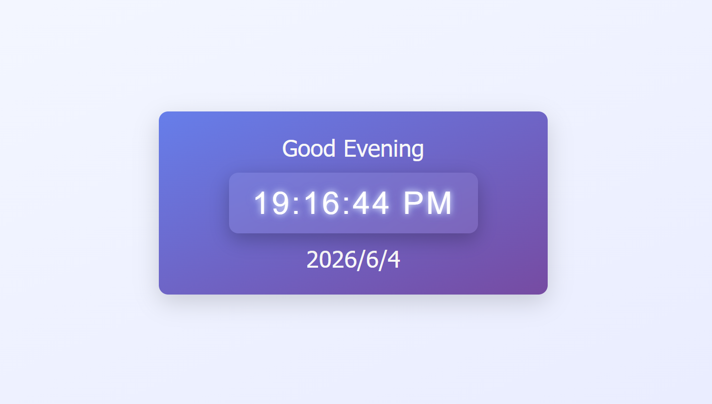

# Learn Building a Digital Clock

A simple and elegant digital clock built with HTML, CSS, and JavaScript.

The application displays the current time, current date, and a greeting message that changes based on the time of day.

## Preview



## Features

- Display current time in real-time
- Display current date
- Show greeting messages based on the time of day
  - Good Morning
  - Good Afternoon
  - Good Evening
  - Good Night
- Update automatically every second
- Clean and modern user interface
- Responsive layout

## Technologies Used

- HTML5
- CSS3
- JavaScript

## What I Learned

- Working with the JavaScript Date object
- Updating content dynamically using the DOM
- Using setInterval() for real-time updates
- Implementing conditional logic
- Creating modern UI with CSS gradients, shadows, and border-radius

## Project Structure

```
digital-clock/
│
├── index.html
├── style.css
├── script.js
├── README.md
└── images/
    └── Digital-Clock.png
```

## Author

Narges Haidari